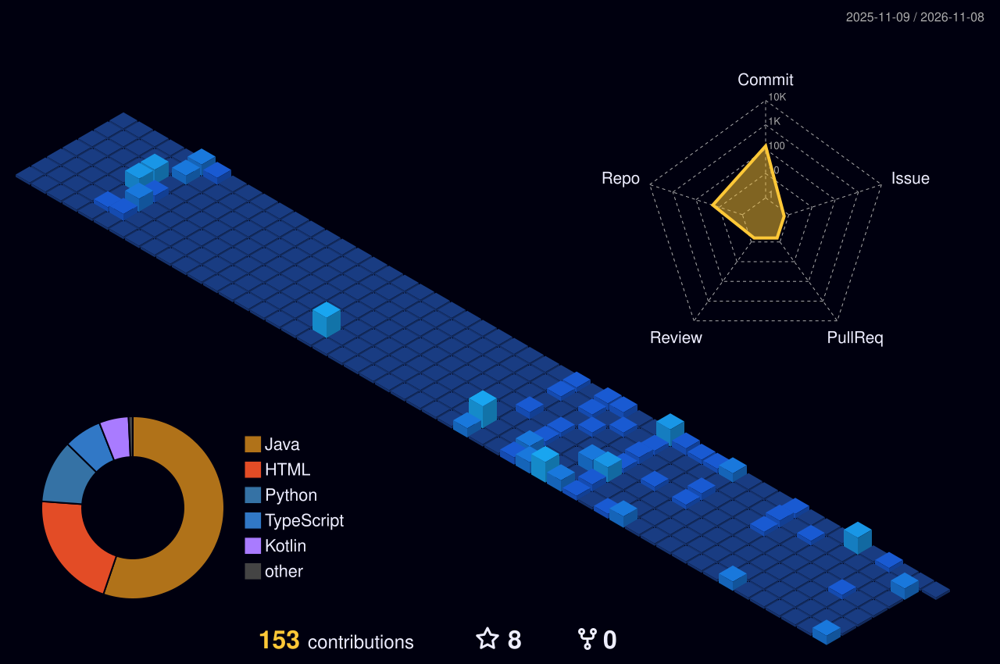
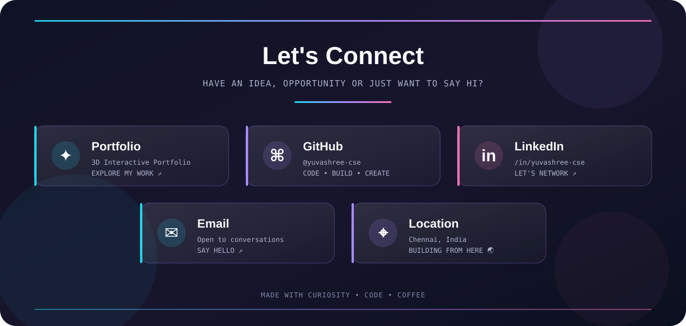

 

  

  
  
  

---

  

## 👩🏻‍💻 About Me

- 🎓 Computer Science and Engineering student at St. Joseph's College of Engineering, Chennai.
- 🤖 Interested in Artificial Intelligence, Large Language Models and Full-Stack Development.
- 🐍 Exploring Python, Java, React, TypeScript and PostgreSQL.
- 🧠 Learning to build practical applications with LangChain and LLMs.
- 🇯🇵 Learning Japanese and working towards future opportunities in Japan.
- 🎨 Interested in creative technology, digital art, anime and cosplay.
- 🚀 Always experimenting, learning and building something new.

**My philosophy:** Learn it. Build it. Break it. Understand it. Build it better.

---

  

## 🛠️ Technologies & Tools

| Category | Technologies |
|---|---|
| Programming | Python, Java, JavaScript |
| Frontend | HTML, CSS, React, TypeScript |
| AI & LLM | LangChain, LLM Development |
| Database | MySQL, PostgreSQL |
| Tools | Git, GitHub, VS Code |

*Currently expanding my skills through hands-on projects and consistent practice.*

---

  

## 🎯 Current Focus

- 💻 Strengthening Data Structures and Algorithms.
- 🐍 Improving Python programming and problem-solving.
- 🤖 Exploring AI applications and LLM development.
- 🌐 Building full-stack projects.
- 📦 Creating and documenting projects on GitHub.
- 🇯🇵 Improving Japanese language proficiency.
- 💼 Preparing for internships and software engineering opportunities.

---

## 🌃 My GitHub Contribution City

  

  <i>Every contribution adds another light to the city. Keep building! 🌆</i>

---

## 💡 Beyond the Code

I enjoy exploring the creative side of technology, too!

- 🎨 Digital art and illustrations
- 🎭 Cosplay and character design
- 🏴‍☠️ Anime and gaming
- ✈️ Travel and adventure
- 🧩 Creative experiments and personal projects

I believe technology and creativity belong in the same playground.

---

  

  <a href="https://lilac-dreamer-portfolio.vercel.app/">🌐 Portfolio</a>
  &nbsp; • &nbsp;
  <a href="https://github.com/yuvashree-cse">💻 GitHub</a>
  &nbsp; • &nbsp;
  <a href="https://www.linkedin.com/in/yuvashree-cse">💼 LinkedIn</a>
  &nbsp; • &nbsp;
  <a href="mailto:yuvashreecv@gmail.com">✉️ Email</a>
  &nbsp; • &nbsp;
  <a href="https://www.google.com/maps/search/?api=1&query=Chennai%2C+India">📍 Chennai, India</a>

---

  <b>Thanks for visiting my little corner of GitHub! 💜</b>
   
  <i>Stay curious. Keep creating. Never stop exploring.</i>

  Designed with creativity, curiosity and lots of coffee ☕

